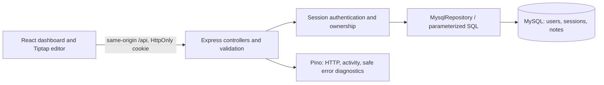

# Application architecture

## Database relationships

- `users`: identity and bcrypt password hash; unique email.
- `sessions`: SHA-256 digest of a random session token; expiry and user foreign key. Raw token is only sent as an HttpOnly cookie.
- `notes`: user foreign key, title, sanitized rich HTML, creation/update timestamps. User and update-time index supports private lists.
- Sessions and notes cascade when their owning user is removed. No account deletion endpoint is exposed by the app.

## HTTP API

Mutation requests require an Origin matching APP_ORIGIN. Authentication endpoints are rate limited.

| Method | Endpoint         | Behaviour                                      |
| ------ | ---------------- | ---------------------------------------------- |
| GET    | /api/health      | Process health                                 |
| POST   | /api/auth/signup | Validate, hash password, create user/session   |
| POST   | /api/auth/login  | Check password; rotate current browser session |
| POST   | /api/auth/logout | Revoke session and clear cookie                |
| GET    | /api/auth/me     | Return safe signed-in identity                 |
| GET    | /api/notes       | List current user's notes                      |
| POST   | /api/notes       | Create owned note                              |
| PUT    | /api/notes/:id   | Update only an owned note                      |
| DELETE | /api/notes/:id   | Move only an owned active note to Trash                      |

Invalid inputs return 400; unauthenticated access 401; foreign origins 403; missing or inaccessible notes 404; duplicate emails 409; oversized JSON 413; excessive authentication attempts 429; unexpected failures 500 with safe wording. Ownership checks deliberately do not reveal another user's note existence.

## Testing layers

- Mocha/Chai + Supertest: authentication and note controller/service behaviour with an isolated repository; SQL ownership contract tests with a stub pool.
- `npm run test:mysql`: actual MySQL integration with unique temporary accounts; cleanup scoped to that run's email addresses.
- Jest/Testing Library: authentication UI, API client errors, search, delete focus/cancel, expiry, retry and profile/logout.
- Real browser acceptance: actual Tiptap and MySQL persistence. Mocks are not evidence of real editor behaviour.
- SonarQube reads JavaScript/JSX and LCOV. Scan status is reported separately from test/build success.

## Scope

Local developer application, not an email-verified production identity service. Password recovery, real-time synchronization and export/import are outside the required implemented scope. Production needs HTTPS, an appropriate reverse proxy, backups and protected credentials. Do not publish the local database or development server.

## Trash and backup additions

- note_trash contains a note_id foreign key and deleted_at timestamp; notes remain in their original table. User ownership is checked through notes on every trash/restore operation. Trashed notes cannot be edited through the normal API.
- GET /api/trash lists only the current user's trashed notes.
- POST /api/notes/:id/restore restores only an owned trashed note.
- POST /api/notes/import validates a versioned batch (1–100 notes), sanitizes all HTML and inserts all notes inside a database transaction. The API JSON body limit remains 150 KB; the UI caps backup files at 140 KB.
- Export uses already-authorized active notes in the browser and excludes user/session data. No permanent delete or automatic trash expiry is exposed.
